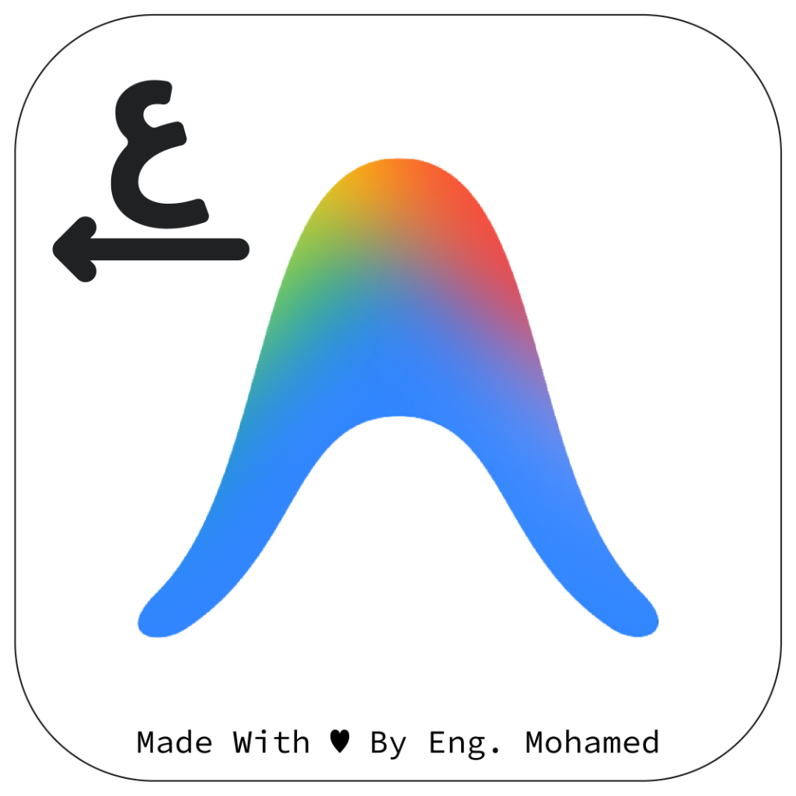
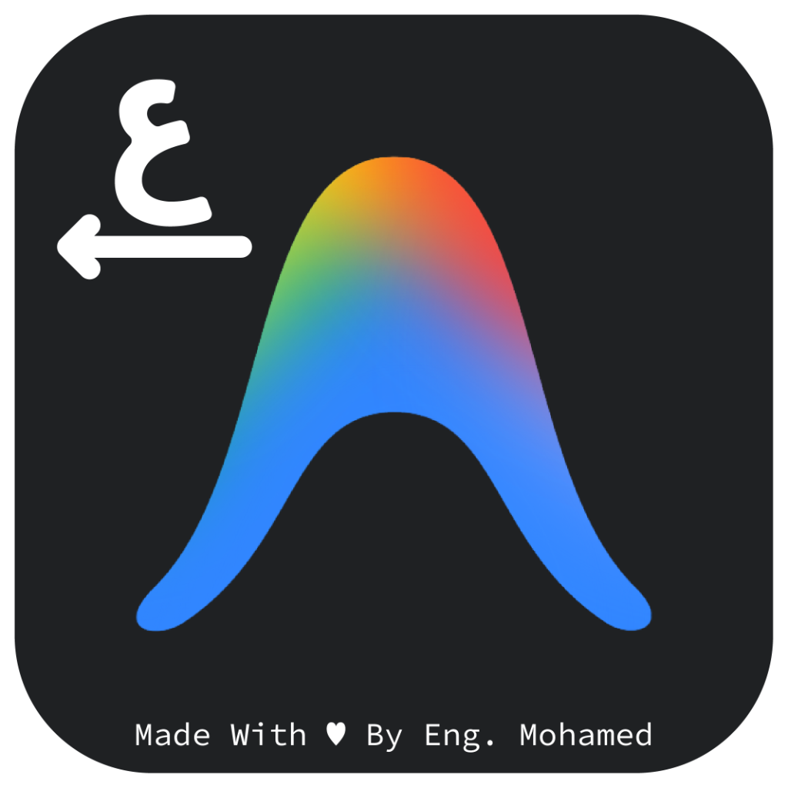

<div align="center">

<p align="center" style="display:flex;align-items:center;justify-content:center;gap:18px;">
  
  
</p>

# 🚀 Antigravity Arabic Suite: Full Arabic & RTL Engine
**محرك التعريب وتكامل الواجهة العربية الشامل لـ Google Antigravity & Antigravity IDE بضغطة زر واحدة.**

<p align="center">
  <a href="https://github.com/Khfaji/antigravity-arabic-suite/releases"></a>
  <a href="https://github.com/Khfaji/antigravity-arabic-suite/stargazers"></a>
  <a href="https://github.com/Khfaji/antigravity-arabic-suite/forks"></a>
  <a href="https://github.com/Khfaji/antigravity-arabic-suite/blob/main/LICENSE"></a>
</p>

<p align="center">
  <br/>
  <b>صُنِعَ بِكُلِّ فَخْرٍ فِي العِرَاقِ</b>
</p>

</div>

---

<div dir="rtl">

## 🌟 أكثر من مجرد أداة لتغيير الاتجاه (Beyond Simple RTL)

ليس هذا المشروع مجرد تعديل شكلي أو سكريبت لتغيير اتجاه الصفحة؛ بل هو **منظومة هندسية متكاملة لبيئة المطور العربي (Arabic Developer Suite)** صُممت خصيصاً للتغلب على التحديات الهيكلية العميقة في تطبيق **Google Antigravity** ومحرره **Antigravity IDE**:

1. **التعامل مع محرر Lexical الحديث:** معالجة معقدة لفقرات المحرر ومسارات `<br>` التلقائية دون المساس بسير الـ Virtual DOM الداخلي.
2. **استقلالية السطر الواحد (Independent Line-by-Line BiDi):** نصوص خليطة في نفس الصندوق أو الرسالة (سطر عربي وسطر إنجليزي)؛ كل سطر يستقل بمحاذاته دون أن يسحب أحدهما الآخر!
3. **ميزة تفوّق عدد الأحرف (Predominant Character Count):** حساب دقيق لعدد الحروف العربية مقابل اللاتينية في السطر الواحد لمنع تشوه النصوص البرمجية أو المصطلحات التقنية.
4. **هندسة بطاقات الانتظار (Queued Messages Architecture):** محاذاة الرسائل المعلقة، مع عكس تسلسل الأزرار تلقائياً وعكس اتجاه أسهم الإرسال بحسب لغة كل رسالة على حدة.
5. **حصانة الأكواد والـ Monaco Editor:** حماية صارمة وشاملة لحاويات الكود البرمجي وشاشات المحرر لضمان بقائها LTR بنسبة 100%.

---

* 🔔 **نظام الإشعارات والتحديث الفوري الذكي (In-App Hot-Updater & A.A.S Status Capsule):**
  - **كبسولة الحالة الذكية (A.A.S Status Pill):** في الحالة المستقرة تظهر كبسولة أنيقة بستروك هادئ `🟢 A.A.S v1.5.6` تفتح نافذة معلومات الأداة وسجل التحديثات وزر الانتقال للمستودع.
  - **تنبيه فوري للتحديثات الجديدة:** عند توفر تحديث جديد تتحول الكبسولة إلى زر نابض باللون الأزرق العميق مع أيقونة تنزيل دائرية.
  - **نافذة سجل التغييرات التفاعلية (Release Notes Modal):** استعراض مميزات كل إصدار بضغطة زر مع خيار تفعيل/إلغاء التحديث التلقائي في الخلفية.
  - **تحديث فوري ومباشر في الذاكرة (One-Click Hot Reload):** تحميل وحقن الكود فورياً دون الحاجة لإعادة تشغيل البرنامج.
* ⚡ **منظومة العدادات الدائرية لحصص النماذج (Model Quotas Circular Gauges & Dual Meters):**
  - **مؤشر دائري متقطع (Dashed Ring Gauge) بجوار الملاحظة الصوتية وشريط الـ Agent في الـ IDE:** يعرض النسبة المتبقية لحصة النموذج مع تلوين ديناميكي ذكي (أخضر $\leftarrow$ برتقالي $\leftarrow$ أحمر).
  - **دعم أصيل كامل لمحرر Antigravity IDE (Native IDE Agent Integration):** حقن مباشر ونظيف بنسبة 100% دون أي إضافات خارجية، مع قراءة رصيد الحساب الخاص بالـ IDE بدقة متناهية.
  - **تطابق تصميمي وبصري كامل 1:1:** تطابق دقيق في درجات الألوان، الخلفيات، النوافذ المنبثقة، وتجربة المستخدم بين التطبيق المستقل ومحرر الأكواد.
  - **عدادات دائرية داخلية متطابقة (Dual Mini Circular Rings):** استبدال أشرطة التقدم الخطية بعدادات دائرية أنيقة مطابقة للتصميم الخارجي لحصة الـ 5 ساعات والحصة الأسبوعية.
  - **فصل دقيق للحصص:** متابعة مستقلة لكل من حصة الـ 5 ساعات (الساعية) والحصة الأسبوعية الشاملة لكل النماذج دون أي تكرار أو تداخل.
  - **انعكاس فوري للاستنفاد (Depletion Protection):** يعكس العداد فوراً نسبة 0% باللون الأحمر الدائري عند نفاد أي من الحصص.
  - **تحديث فوري وتفاعلي:** إمكانية النقر على العداد أو زر "تحديث" داخل النافذة لجلب أحدث حالة للحصص من الخادم مباشرة.
* 📝 **القوائم الذكية والتنقيط التلقائي الأصلي (Lexical Native Smart Lists):**
  - **الترقيم التلقائي المتسلسل (Smart Auto-Numbering):** يدعم الأرقام الغربية (`1.`, `1-`, `1)`) والأرقام العربية/المشرقية (`١.`, `١-`, `١)`)، حيث ينتقل تلقائياً للرقم التالي عند الضغط على `Enter` أو `Shift+Enter`.
  - **التنقيط الذكي (Smart Bullet Lists):** يحول تلقائياً الشرطة (`- `) أو النجمة (`* `) في بداية السطر الأول أو أي سطر إلى نقطة (`• `) قياسية وجميلة مع الحفاظ على محاذاة الـ RTL الكاملة.
  - **الخروج الذكي من القائمة:** الضغط على سطر فارغ في القائمة ينهي الترقيم أو التنقيط فوراً ويعود لسطر عادي دون الحاجة لحذف يدوي.
  - **تكامل أصلي مع Lexical AST:** تعديل القوائم يتم برمجياً داخل شجرة الـ AST للمحرر، مما يمنع مسح النصوص أو تشوه مؤشر الكتابة (Caret).
* 🎯 **توجيه ديناميكي للسطور والفقرات (`unicode-bidi: plaintext`):** يتيح كتابة فقرات مشتركة، بحيث يبدأ السطر العربي من اليمين تماماً، والسطر الإنجليزي من أقصى اليسار داخل نفس صندوق الإدخال.
* ⚖️ **حساب غلبة الحروف (Predominant BiDi Engine):** السطر الذي يحتوي 90% إنجليزي مع كلمة عربية يبقى LTR، بينما السطر ذو الغالبية العربية يتجه لليمين تلقائياً.
* ⏳ **حل جذري لقائمة الانتظار (Queued Messages):**
  - الرسائل العربية تستقر في اليمين، وتترتب أدوات التحكم فيها بالترتيب (حذف $\leftarrow$ تعديل $\leftarrow$ إرسال).
  - سهم الإرسال العربي ينقلب أفقياً (`scaleX(-1)`) ليشير باتجاه اليسار المناسب للـ RTL.
  - الرسائل الإنجليزية تحتفظ بمحاذاتها اليسارية وترتيب أدواتها (Delete $\rightarrow$ Edit $\rightarrow$ Send).
* 🌲 **محرك المراقبة الشاملة والمستمرة (Hybrid Observer + Sync Engine):** يراقب كل تغيرات الـ DOM ويدمج تزامناً دورياً خفيفاً للغاية (< 15MB ذاكرة) لضمان تطبيق القواعد على أي رسالة جديدة فور إضافتها.
* 💻 **دعم متكامل وشامل (Standalone Desktop App & Antigravity IDE):** تثبيت وتفعيل إضافة الـ RTL الرسمية داخل محرر IDE برمجياً وبصمت تام.
* 🤖 **قواعد التوجيه المعرفي للذكاء الاصطناعي (`AGENTS.md` / `GEMINI.md`):** حقن تعليمات إلزامية تجبر الوكيل والمودل على صياغة الردود العربية بتغليف RTL صحيح مع عزل الأكواد بمسارات LTR واضحة.
* 🔄 **إعادة حقن واستجابة فورية بعد التحديثات (Update-Resilient CDP Engine):** ترصد الخدمة في الخلفية تشغيل نوافذ Antigravity فورياً وتقترن بها عبر بروتوكول التشخيص (CDP)، مما يضمن استمرار وتطبيق دعم العربية تلقائياً حتى عند قيام Google بطرح تحديثات واستبدال ملفات التطبيق.
* 🚀 **إقلاع مزدوج ذكي وشامل (Antigravity & IDE Dual-Launcher Pairing):** يقترن محرك الـ RTL تلقائياً باختصارات تشغيل كلٍّ من **تطبيق Antigravity ومحرر Antigravity IDE** على سطح المكتب وقائمة ابدأ؛ فيعمل الدعم تلقائياً عند فتحك لأيٍّ منهما حتى لو لم تكن الخدمة تعمل عند تسجيل الدخول!
* 🛡️ **استقرار وحصانة فائقة ضد التوقف (Hardened Background Daemon):** معالجة متقدمة لجميع استثناءات الاتصال وقطع الـ WebSocket، مع تشغيل هادئ ومستقل مع بدء النظام (Windows Startup) وبدون أي تأثير على أداء النظام (< 15MB ذاكرة).

---

## 🚀 التثبيت السريع (بضغطة زر واحدة)

### 📥 تحميل ملف التثبيت المباشر (Standalone Setup)

<div align="center">

<a href="https://github.com/Khfaji/antigravity-arabic-suite/releases/latest/download/Antigravity-Arabic-Setup.exe">
  
</a>

<p style="margin-top:10px;font-size:13px;color:#94a3b8;">
حجم الملف: <b>~650 KB فقط</b> • حزمة مدمجة ومستقلة بالكامل ولا تحتاج لأي إعدادات مسبقة
</p>

</div>

1. حمّل ملف التثبيت: **[Antigravity-Arabic-Setup.exe](https://github.com/Khfaji/antigravity-arabic-suite/releases/latest/download/Antigravity-Arabic-Setup.exe)**.
2. شغّل الملف بنقرة مزدوجة (`Double-Click`)، وسيتولى البرنامج تثبيت المحرك، تهيئة الخطوط، وضبط الأيقونات والاختصارات لكلا التطبيقين (**Antigravity Desktop** و **Antigravity IDE**) في ثوانٍ معدودة.

> [!NOTE]
> **ملاحظة حول تنبيه الأمان (Windows SmartScreen):**
> نظراً لأن الأداة حديثة ومجانية ومفتوحة المصدر ولا تحمل شهادة توقيع تجارية مدفوعة من مايكروسوفت؛ قد تظهر لك نافذة حماية ويندوز الزرقاء (*Windows protected your PC*).
> لتخطي التنبيه: اضغط على **"More info" (المزيد من المعلومات)** ثم اضغط على زر **"Run anyway" (التشغيل على أي حال)**.

---

## 📜 سجل الإصدارات والتغييرات (Changelog & Release History)

### 🌟 الإصدار v1.5.6 (التحديث الأخير)
* 🎨 **الهوية البصرية والأيقونات الرسمية الجديدة:**
  * اعتماد الأيقونة الرسمية البيضاء المحدثة لتطبيق `Antigravity Desktop` وملف التثبيت التنفيذي.
  * اعتماد الأيقونة الرسمية الداكنة المحدثة لمحرر `Antigravity IDE`.
* 👤 **عرض بيانات الحساب النشط:**
  * إظهار اسم الحساب والبريد الإلكتروني مباشرة تحت عنوان "حصة النماذج" في المنبثقة للتأكد من الحساب الحالي المستخدم.
* ⚡ **تطوير زر تحديث الحصص والأنميشن:**
  * تحويل الزر إلى أيقونة مدمجة ونظيفة تدور باللون الأصفر مع منحنى حركة سلس وزمن عرض كافٍ (`800ms`) مع حماية تامة ضد التعليق.
* 🛡️ **عزل تنسيقات الـ IDE وحماية الأيقونات:**
  * عزل الخط العربي وتنسيقات القوائم لتقتصر على لوحة المحادثة فقط، وحماية أيقونات VS Code و Codicons الأصلية من أي تشوه.
* 🔄 **استقرار الحقن بعد الـ Refresh:**
  * تعزيز بقاء واستقرار الحزمة بعد إعادة تحميل الصفحة أو فتح مشروع جديد عبر `Page.addScriptToEvaluateOnNewDocument`.

---

### 📦 الإصدار v1.5.5
* 🎯 **دعم كوتا مستقلة ومخصصة لنموذج Gemini 4 Argon:**
  * التعرف التلقائي على نموذج Argon وفصل حصته الأسبوعية بشكل مستقل ومطابق للنظام دون دمجه مع بقية نماذج Gemini.
  * عرض شارات الحصة الأسبوعية ومواعيد التجديد بدقة متناهية في كل من المنبثقة وشريط الإدخال.
* 💬 **إلغاء خوارزمية غلبة اللغة (Language Predominance) في الشات:**
  * إلغاء فحص غلبة اللغة (BiDi Ratio) الذي كان يؤثر على سياق الرسائل والمحاذاة عند اختلاط اللغتين.
  * الاعتماد حصرياً على منطق البداية القوية الطبيعي (First-Strong Character) للحفاظ على سلاسة الفقرات دون أي ارتباك في الاتجاه.
* 🛠️ **إصلاح جذري لمنبثقة المودلات (Models Popover Card):**
  * حل مشكلة تشوه فقاعة المودلات والعدادات التي كانت تظهر كنصوص برمجية غير منسقة.
  * إعادة بناء قوالب الرسم والـ SVG لتعمل بانسيابية تامة، وضمان ظهور العدادات الدائرية المصغرة وتوقيتات التجديد لكل نموذج بدقة فائقة.
* 🔄 **تطابق كامل وموثوق في التحديث التلقائي:**
  * مزامنة التعديلات عبر محركي تطبيق سطح المكتب ومحرر Antigravity IDE ليعملا بتوافق وتطابق 100%.

---

### 📦 الإصدار v1.5.0
* 🚀 **المحرك الأصيل المباشر لمحرر Antigravity IDE (Native Agent Engine):**
  * حقن تقني مباشر ونظيف داخل واجهة الـ Agent Panel بالمحرر دون الحاجة لأي إضافات خارجية في المتجر.
  * أداء فائق السرعة، خفيف على الموارد، ومتوافق 100% مع معايير الأمان و Trusted-Types الصارمة.
* ⚡ **حلقة الحصص الدائرية التفاعلية للـ IDE (Quota Ring & Models Popover):**
  * إضافة المؤشر الدائري المنقط بجوار صندوق الإدخال في الـ IDE لمتابعة الرصيد ونسبة استهلاك النموذج النشط لحظياً.
  * نافذة منبثقة تفاعلية لعرض كافة نماذج الذكاء الاصطناعي، توقيتات إعادة التعيين (Reset Times)، ونسب الرصيد المتبقي.
* 🎨 **تطابق بصري وتصميمي بنسبة 100% (Visual & Design Parity):**
  * توحيد درجات الألوان والخلفيات الداكنة (#1c1c1c و #252525) بدقة بصرية كاملة بين تطبيق سطح المكتب ومحرر الكود.
* 🏛️ **معمارية مستقلة ومرنة بالكامل (Decoupled Architecture):**
  * يعمل كل برنامج باستقلالية تامة دون أي اعتمادية إجبارية على الآخر؛ سواء كان منصباً تطبيق سطح المكتب فقط، أو الـ IDE فقط، أو كلاهما معاً.

---
* 🏷️ **عزل أرقام الإصدارات والأقواس ثنائية الاتجاه (BiDi Auto-Isolation via LRM):**
  * معالجة ذكية ومحكمة لانعكاس أرقام الإصدارات المعقدة والأقواس عند كتابتها داخل النصوص العربية مثل `1.4.(1)` أو `1.(4).1` أو `(1.4.1)` دون أن يُرمى القوس لبداية الرقم.
  * عزل ديناميكي فوري باستخدام علامة الاتجاه اليساري غير المرئية (`\u200E` - LRM) لضمان المحاذاة المنطقية والبصرية الصحيحة.
  * تطبيق فوري وتفاعلي أثناء الكتابة في محرر `Lexical` مع الحفاظ التام على موقع المؤشر (Caret) وسجل التراجع.
  * معالجة تلقائية شاملة لجميع فقاعات ورسائل الشات الحالية والواردة وقوائم الانتظار في الواجهة.

---

### 📦 الإصدار v1.4.0
* 🚀 **إطلاق نظام التحديث الفوري المباشر (One-Click Hot Reload & Self-Updater):**
  * كبسولة تنبيه ذكية متوهجة بنبض داكن وأنيق مع أيقونة تنزيل دائرية عند توفر إصدار جديد.
  * إمكانية تحديث الأداة وحقنها فورياً في الذاكرة دون الحاجة لإعادة تشغيل البرنامج نهائياً.
  * نافذة تفاعلية لسجل التغييرات مع خيار تفعيل/إلغاء التحديث التلقائي في الخلفية.
  * كبسولة الحالة المستقرة `A.A.S v1.4.0` مع نافذة معلومات متكاملة وزر لزيارة المستودع.
* ⚡ **منظومة العدادات الدائرية المتطابقة لحصص النماذج (Dual Circular Gauges):**
  * تصميم عدادات دائرية داخلية (Circular Rings) بدلاً من الأشرطة الخطية التقليدية مطابقة للعداد الخارجي تماماً.
  * عداد دائري مستقل لحصة الـ 5 ساعات (الساعي) وعداد دائري مستقل للحصة الأسبوعية لكل نموذج.
  * فصل الحصة الساعية عن الحصة الأسبوعية لمنع تكرار النسب وضمان قراءة دقيقة لكل فترة.
  * تصحيح ارتباط الحصص بالخوادم لعكس الاستنفاد التام (0%) فور نفاد الرصيد.

---

### 📦 الإصدار v1.3.0
* ⚡ **إضافة العداد الدائري الذكي لحصة النماذج (Model Quotas Circular Gauge & Popover):**
  * مؤشر دائري متقطع وأنيق (Dashed Ring Gauge) يعرض نسبة النموذج النشط كرقم مباشر.
  * نافذة عائمة متقدمة تعرض نسب النماذج وتوقيتات التجديد مع دعم كامل للاتجاهين.
* 🌐 **تحسينات إضافية على اتجاه الواجهات ثنائية اللغة.**

---

### 📦 الإصدار v1.2.0
* ✨ **إضافة نظام القوائم الذكية (Smart Lists) داخل محرر Lexical:**
  * **الترقيم التلقائي المتسلسل (Auto-Incrementing Numbering):** دعم الترقيم الذكي بالأرقام الإنجليزية (`1.`, `2.`) والأرقام العربية المشرقية (`١.`, `٢.`) مع استمرار الترقيم تلقائياً عند النزول لسطر جديد.
  * **التنقيط الذكي (Smart Bullet Formatting):** تحويل الشرطات (`- `) والنجوم (`* `) تلقائياً إلى نقاط تعداد (`• `) في السطر الأول وكافة السطور التالية.
  * **معالجة شجرة الـ AST لمحرر Lexical:** تنفيذ عمليات استبدال النصوص عبر `spliceText` و `lex.update` لمنع فقدان مؤشر الفأرة وتجنب أي مسح عشوائي للنصوص.
* 🛠️ **حل مشكلة السطر الأول في القوائم:** فحص شامل وتحديث فوري لجميع فقرات المحرر السابقة والسطر الأول لضمان تحويلها للنقطة فوراً دون الحاجة لترك سطر فارغ.
* 🛡️ **تعزيز استقرار خدمة الخلفية (Service Hardening):**
  * إضافة حواجز أمان `uncaughtException` و `unhandledRejection` لمنع إغلاق الخدمة المفاجئ.
  * حماية قنوات اتصال Chrome DevTools Protocol عند إغلاق النوافذ أو إعادة تشغيلها.

---

### 📦 الإصدار v1.1.0
* ⚖️ **محرك التحليل الديناميكي لغالبية اللغة (Line-by-Line Predominant BiDi):**
  * فحص متقدم لنسبة الحروف العربية مقارنة بالحروف اللاتينية لكل سطر وفقرة بشكل مستقل داخل محرر الإدخال والردود.
  * التبديل التلقائي لاتجاه الفقرة إلى RTL عند كتابة العربية و LTR عند كتابة الأكواد والإنجليزية.
* 🚀 **نظام الإقلاع المزدوج (Dual-Launcher Integration):**
  * ربط اختصارات سطح المكتب وقائمة ابدأ لتشغيل الخدمة تلقائياً مع محرر Antigravity IDE وتطبيق Antigravity الرئيسي.
* 🔄 **التوافق التلقائي مع تحديثات Google Antigravity:** الاعتماد التام على آلية الرصد الديناميكي CDP بدلاً من تعديل الملفات المحمية لمنع ضياع التعريب بعد التحديثات.

---

### 🚀 الإصدار v1.0.0 (الإطلاق الأولي)
* 🎉 الإطلاق الرسمي لمحرك **Antigravity Arabic Suite**.
* 🌐 دعم اتجاه اليمين إلى اليسار (RTL) لرسائل الدردشة، والردود، والبطاقات الجانبية.
* ⏳ دعم رسائل قائمة الانتظار (Queued Messages) وعكس أدوات التحكم وسهم الإرسال.
* 💻 تثبيت وتفعيل حزمة اللغة والـ RTL في بيئة Antigravity IDE.
* 🤖 حقن قواعد المساعد الآلي لتوليد الردود بتنسيق RTL سليم مع عزل الأكواد البرمجية.

---

## 🛠️ البنية التقنية وميكانيكية العمل

<div dir="ltr" align="center">

```text
+-------------------------------------------------------------+
|                 Google Antigravity Runtime                  |
+------------------------------+------------------------------+
                               |
           [Chrome DevTools Protocol (CDP) / Preload]
                               |
                               v
+-------------------------------------------------------------+
|                Antigravity Arabic RTL Engine                |
|  - BiDi Plaintext Rule Engine (Strict Paragraph Isolation)  |
|  - Predominant Language Detection (Arabic vs Latin Count)   |
|  - Lexical AST Native Smart Lists (Numbering & Bullets)     |
|  - Queued Messages Mirrored Controls & Arrow Inversion      |
|  - MutationObserver + Periodic Micro-Task Sync              |
+-------------------------------------------------------------+
```

</div>

1. **الربط الداخلي الآمن:** يتم الاتصال بنافذة العرض عبر بروتوكول DevTools أو عبر حقن معزول تماماً لا يمس شفرة المصدر الأساسية.
2. **عزل الأكواد البرمجية:** استثناء صريح لعناصر `pre, code, .monaco-editor, [class*="shiki"]` لضمان عدم تأثر أي كود أو محرر برمجي بالـ RTL.
3. **تطبيق القواعد المركزية:** دمج ملفات القواعد الموجهة في مسار `~/.gemini/config/rules/` للتأكد من امتثال المساعد الآلي لتعليمات اللغة العربية.

---

## 🗑️ إلغاء التثبيت

لحذف الخدمة واستعادة إعدادات التطبيق الافتراضية بنظافة تامة:
* شغّل ملف **`uninstall.bat`** وستتم إزالة كافة التعديلات والقواعد بأمان.

<br />

<div align="center">

<br/>
<b>صُنِعَ بِكُلِّ فَخْرٍ فِي العِرَاقِ</b>

</div>

</div>

---

## 🌐 English Summary

**Antigravity Arabic Suite** is a full-fledged bidirectional (BiDi) localization engine engineered specifically for Google Antigravity and Antigravity IDE on Windows:
* **Model Quota Circular Gauge & Hover Popover:** Elegant circular progress indicator right next to the voice memo button displaying real-time remaining quota for the active model with color thresholds, instant refresh on click, and an interactive popover showing all available models and their reset times.
* **Smart Auto-Lists & Bullets:** Native Lexical AST manipulation for auto-incrementing numbered lists (both Latin `1.` and Eastern Arabic `١.`) and automatic `- ` / `* ` to `• ` bullet conversion without cursor jumping or text loss.
* **True Line-by-Line BiDi:** Allows mixed-language paragraphs in Lexical chat input without cross-line text corruption.
* **Predominant Language Counting:** Calculates character frequency to determine line direction, keeping code and tech terms strictly LTR.
* **Smart Queued Messages Handling:** Automatically aligns queued cards with mirrored action buttons and flipped send arrows for RTL messages.
* **Dual-Launcher & Shortcut Pairing:** Automatically pairs with Desktop & Start Menu shortcuts for both **Antigravity and Antigravity IDE** to fire the background daemon whenever you launch either, guaranteeing RTL is always active.
* **Update-Resilient Architecture:** Runs independently via Chrome DevTools Protocol & Windows Startup, automatically attaching to Antigravity runtime even after Google updates the application packages.
* **Zero Disruption to Code:** Monaco editor, Markdown code blocks, and syntax containers remain completely LTR.
* **Seamless Installation:** One-click automated setup with zero manual configuration.

---

### License
This project is licensed under the [MIT License](LICENSE).
